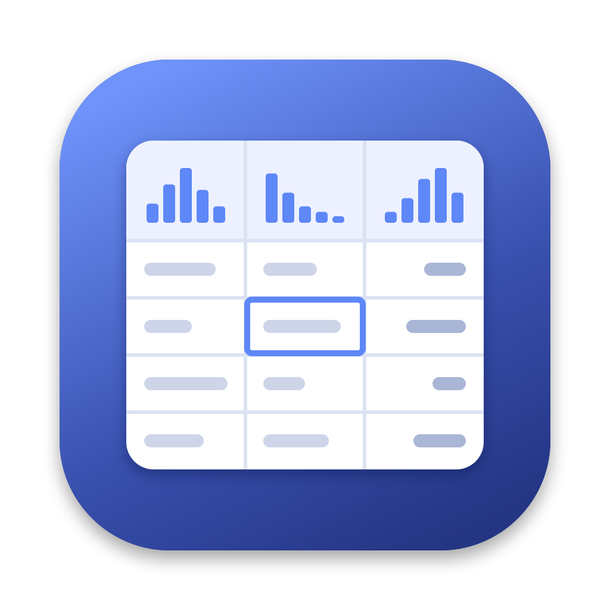
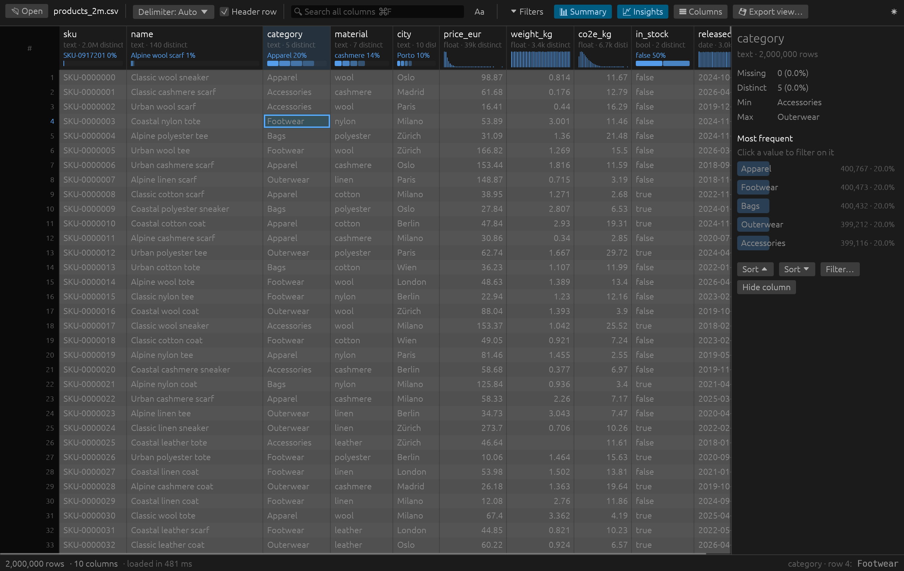
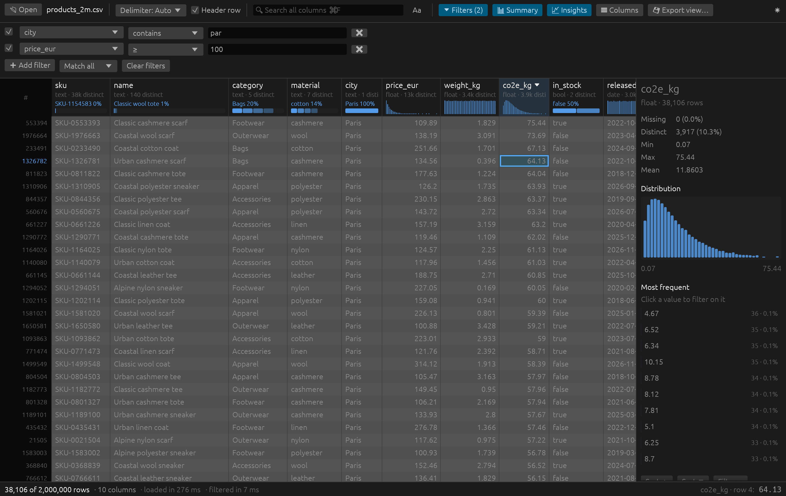

<p align="center"></p>

# csvdeck

A fast CSV and Parquet viewer for macOS, written in Rust. It sits between [Modern CSV](https://www.moderncsv.com/) (speed, keyboard-driven grid) and VS Code's [Data Wrangler](https://marketplace.visualstudio.com/items?itemName=ms-toolsai.datawrangler) (column profiles in the header).



> **Who wrote this:** all the code, the icon and this README were written by **Claude Opus 5.5** (Anthropic), working in Claude Code. Félix Le Chevallier wrote the prompts, tested the app and made the product calls. No line of code was written by a human.

## Features

- **Opens big files without breaking a sweat**: CSV, TSV, PSV and Parquet. The grid only draws what's on screen, and parsing, filtering and profiling run on background threads with [Polars](https://pola.rs).
- **Column profiles in every header**: type, distinct count, % missing, plus a histogram or top-values bar. A side panel adds min, max, mean and the 10 most frequent values; click one to filter on it.
- **Filters and search**: search across all columns, or build filters with contains, =, ≠, starts with, ends with, regex, >, <, is empty, combined with match all or match any. Sort by double-clicking a header.
- **Spreadsheet-style grid**: header and row numbers stay put while you scroll, resizable columns, range selection, ⌘C copies as TSV, double-click a cell to see its full value.
- **Export** the filtered view to CSV or Parquet. Hide columns, light and dark themes, delimiter auto-detection.



### Speed and memory

On a 10-core Apple Silicon Mac, the status bar reported 276 to 490 ms to load the 2M-row, 170 MB CSV, and 7 ms for the two filters in the screenshot above.

Memory is the physical footprint (from `vmmap --summary`) on generated product files, after loading and profiling finished:

| File | csvdeck |
|---|---|
| 900k rows, 77 MB CSV | 193 MB |
| 2M rows, 170 MB CSV | ~390 MB (peaks around 1 GB while loading) |

For comparison, Excel reached about 1 GB on the 900k-row file and crashed.

## Install

Download `csvdeck.app.zip` from the releases page if there is one, unzip it and move it to `/Applications`. The app is not notarized, so macOS blocks it the first time: open **System Settings → Privacy & Security** and click **Open Anyway**. It only runs on Apple Silicon Macs.

To build it yourself, install Rust with [rustup](https://rustup.rs), then run:

```bash
./bundle.sh                       # builds dist/csvdeck.app
cp -R dist/csvdeck.app /Applications/
```

The pinned toolchain (`rust-toolchain.toml`) installs itself on the first build. A first release build takes about 5 minutes, mostly compiling Polars.

From a terminal: `target/release/csvdeck path/to/file.csv`.

## Keyboard

| Keys | Action |
|---|---|
| ⌘O / ⌘F | Open file / search all columns |
| Arrows, Page Up/Down, Tab, Enter | Move the cursor |
| ⌘ + arrow | Jump to an edge |
| Shift + move or click | Extend the selection |
| ⌘A / ⌘C / Esc | Select all / copy as TSV / clear the selection |

## Not there yet

Cell editing, tabs (one file per window), sorting by more than one column, Excel files, an Intel Mac build.

## Layout

- `src/engine.rs` handles loading, filtering, sorting, column profiles and export (Polars). `cargo test` covers it.
- `src/main.rs` is the UI (egui): a custom-drawn grid, panels, keyboard handling, and the hook that receives files opened from Finder.
- `bundle.sh` assembles the `.app`; `assets/icon.swift` draws the icon.
